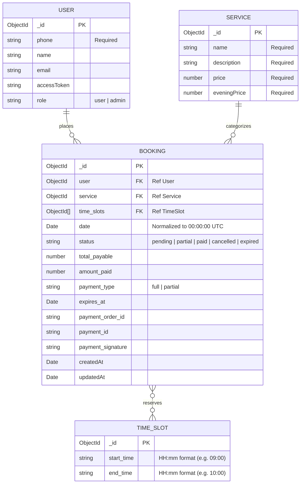
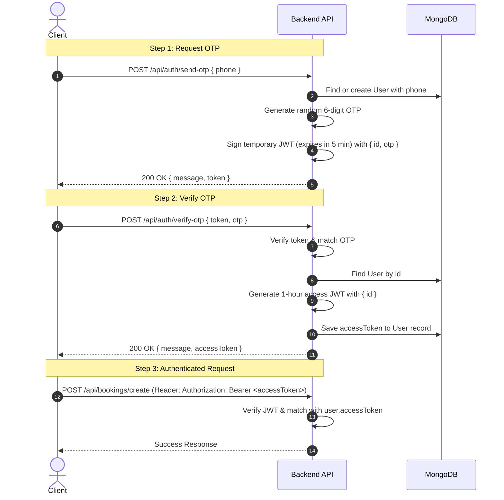
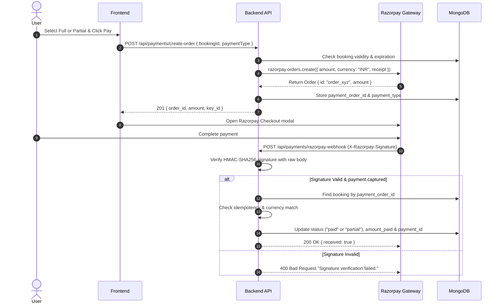

# Backend API & System Documentation

Comprehensive technical documentation for the Turf & Venue Booking System backend.

---

## Table of Contents

1. [System Overview &amp; Architecture](#1-system-overview--architecture)
2. [Environment Configuration](#2-environment-configuration)
3. [Database Models &amp; Schemas](#3-database-models--schemas)
4. [Authentication &amp; Authorization](#4-authentication--authorization)
5. [Complete API Reference](#5-complete-api-reference)
   - [Auth Endpoints](#auth-endpoints-apiauth)
   - [Services Endpoints](#services-endpoints-apiservices)
   - [Time Slots Endpoints](#time-slots-endpoints-apitime-slots)
   - [Bookings Endpoints](#bookings-endpoints-apibookings)
   - [Payments Endpoints](#payments-endpoints-apipayments)
6. [Payment &amp; Webhook Architecture](#6-payment--webhook-architecture)
7. [Background Tasks &amp; Automation](#7-background-tasks--automation)
8. [Database Seeding](#8-database-seeding)
9. [Developer Notes &amp; Bug Audits](#9-developer-notes--bug-audits)

---

## 1. System Overview & Architecture

### Tech Stack

- **Runtime**: Node.js (ES Modules `"type": "module"`)
- **Web Framework**: Express.js 5 (`express: ^5.3.0`)
- **Database**: MongoDB via Mongoose ODM (`mongoose: ^9.11.2`)
- **Authentication**: JWT (`jsonwebtoken: ^9.0.3`) with OTP phone authentication
- **Payment Processing**: Razorpay API (`razorpay: ^2.9.8`) with Webhook HMAC verification
- **Scheduler**: Node-Cron (`node-cron: ^4.6.0`)
- **Security & Utils**: Native `node:crypto`, `bcrypt: ^6.0.0`, `dotenv: ^18.0.8`

### Directory Structure

```
backend/
├── app.js                      # Express application setup & middleware mounting
├── config/
│   ├── db.config.js            # MongoDB Mongoose connection
│   └── razorpay.config.js      # Razorpay client instance
├── controllers/
│   ├── auth.controller.js / user.controller.js  # OTP sending and verification
│   ├── booking.controller.js   # Slot booking validation & creation
│   ├── payment.controller.js   # Razorpay orders and webhook handling
│   ├── service.controller.js   # Sport/service CRUD
│   └── time_slot.controller.js # Slot generation and date availability calculation
├── data/
│   └── seed.time_slots.js      # Seeder for default hourly time slots
├── index.js                    # Server entrypoint (db connection + app.listen)
├── middlewares/
│   └── auth.middleware.js      # JWT authentication and user session verification
├── models/
│   ├── booking.model.js        # Booking schema and states
│   ├── service.model.js        # Service/Sport offering schema
│   ├── time_slot.model.js      # Time slot definitions
│   └── user.model.js           # User profile and accessToken store
├── routes/
│   ├── auth.router.js          # /api/auth routes
│   ├── booking.router.js       # /api/bookings routes
│   ├── payments.router.js      # /api/payments routes (webhook + orders)
│   ├── service.router.js       # /api/services routes
│   └── time_slot.router.js     # /api/time-slots routes
├── services/
│   └── cron.service.js         # Scheduled job to expire unpaid pending bookings
├── package.json
└── documentation.md            # This documentation file
```

---

## 2. Environment Configuration

The backend reads environment variables via `dotenv/config`. These should be defined in a `.env` file in the root of the `backend/` directory:

| Variable                    | Type   | Required      | Description                                                           | Example                                      |
| :-------------------------- | :----- | :------------ | :-------------------------------------------------------------------- | :------------------------------------------- |
| `PORT`                    | Number | Optional      | Port for the HTTP server to listen on. Defaults to `5000`.          | `5000`                                     |
| `DATABASE_URL`            | String | **Yes** | MongoDB connection string URI.                                        | `mongodb://localhost:27017/booking_system` |
| `JWT_SECRET`              | String | **Yes** | Cryptographic secret for signing OTP and Access JWT tokens.           | `super_secret_jwt_key_123`                 |
| `RAZORPAY_KEY_ID`         | String | **Yes** | Razorpay public key ID.                                               | `rzp_test_Tphvjvz1YKTTQd`                  |
| `RAZORPAY_KEY_SECRET`     | String | **Yes** | Razorpay private API secret.                                          | `Q5QtW0oamQWrtDSLxdbzfs4f`                 |
| `RAZORPAY_WEBHOOK_SECRET` | String | **Yes** | Secret configured in the Razorpay Webhooks dashboard.                 | `my_webhook_secret_key`                    |
| `PARTIAL_PAYMENT_PERCENT` | Number | Optional      | Percentage required when partial payment is selected. Default `30`. | `30`                                       |

---

## 3. Database Models & Schemas



### Schema Details

#### `User` (`backend/models/user.model.js`)

- `phone` (String, required): Mobile number used for OTP authentication.
- `name` (String, optional): Full name of the user.
- `email` (String, optional): Email address.
- `accessToken` (String, optional): Active JWT token stored in user record for session invalidation.
- `role` (String, enum: `["user", "admin"]`, default: `"user"`).

#### `Service` (`backend/models/service.model.js`)

- `name` (String, required): Name of the facility/sport (e.g., `"Football Turf"`).
- `description` (String, required): Detailed description.
- `price` (Number, required): Standard rate per time slot.
- `eveningPrice` (Number, required): Evening slot pricing rate.

#### `TimeSlot` (`backend/models/time_slot.model.js`)

- `start_time` (String, required): 24-hour time representation `"HH:mm"` (e.g., `"09:00"`).
- `end_time` (String, required): 24-hour time representation `"HH:mm"` (e.g., `"10:00"`).

#### `Booking` (`backend/models/booking.model.js`)

- `user` (ObjectId, ref: `User`, required): The booking user.
- `service` (ObjectId, ref: `Service`, required): The reserved service.
- `time_slots` (Array of ObjectId, ref: `TimeSlot`, required): One or more reserved slots.
- `date` (Date, required): Date of booking (stored at UTC midnight).
- `status` (String, enum: `["pending", "partial", "paid", "cancelled"]`, default: `"pending"`).
- `total_payable` (Number, default: `0`): Total booking amount (`service.price * time_slots.length`).
- `amount_paid` (Number, default: `0`): Amount paid to date in INR.
- `payment_type` (String, enum: `["full", "partial"]`, default: `"full"`).
- `expires_at` (Date, required): Expiration timestamp for payment completion (5 minutes from creation).
- `payment_order_id` (String): Razorpay Order ID (`order_...`).
- `payment_id` (String): Razorpay Payment ID (`pay_...`).
- `payment_signature` (String): Webhook/Razorpay signature.
- `timestamps`: Automatic `createdAt` and `updatedAt`.

---

## 4. Authentication & Authorization

Authentication is passwordless and relies on mobile OTP verification.



### Passing Authentication Header

Protected routes require the HTTP `Authorization` header:

```http
Authorization: Bearer <accessToken>
```

*(Alternatively, the middleware checks `req.cookies.token` if cookie parser is enabled).*

---

## 5. Complete API Reference

Base URL: `http://localhost:5000` (or configured `PORT`)

---

### Auth Endpoints (`/api/auth`)

#### 1. Send OTP

Generates a 6-digit one-time password and returns a temporary token valid for 5 minutes. If a user with the provided phone does not exist, a new user record is created.

- **Method**: `POST`
- **Endpoint**: `/api/auth/send-otp`
- **Access**: Public
- **Headers**:
  - `Content-Type: application/json`

**Request Body**:

| Field     | Type   | Required | Description                                |
| :-------- | :----- | :------- | :----------------------------------------- |
| `phone` | String | Yes      | User phone number (e.g. `"9876543210"`). |

```json
{
  "phone": "9876543210"
}
```

**Expected Responses**:

- **`200 OK`**:
  ```json
  {
    "message": "OTP sent successfully",
    "token": "eyJhbGciOiJIUzI1NiIsInR5cCI6IkpXVCJ9..."
  }
  ```
- **`400 Bad Request`**:
  ```json
  {
    "message": "Phone number is required"
  }
  ```
- **`500 Internal Server Error`**:
  ```json
  {
    "message": "Internal server error",
    "error": "Database connection timed out"
  }
  ```

**cURL Example**:

```bash
curl -X POST http://localhost:5000/api/auth/send-otp \
  -H "Content-Type: application/json" \
  -d '{"phone": "9876543210"}'
```

---

#### 2. Verify OTP

Verifies the submitted 6-digit OTP against the signed temporary JWT. Upon successful verification, generates a 1-hour session `accessToken`, persists it into the user document, and returns it.

- **Method**: `POST`
- **Endpoint**: `/api/auth/verify-otp`
- **Access**: Public
- **Headers**:
  - `Content-Type: application/json`

**Request Body**:

| Field     | Type   | Required | Description                                               |
| :-------- | :----- | :------- | :-------------------------------------------------------- |
| `token` | String | Yes      | Temporary JWT token returned from `/api/auth/send-otp`. |
| `otp`   | String | Yes      | 6-digit OTP code (e.g. `"123456"`).                     |

```json
{
  "token": "eyJhbGciOiJIUzI1NiIsInR5cCI6IkpXVCJ9...",
  "otp": "648291"
}
```

**Expected Responses**:

- **`200 OK`**:

  ```json
  {
    "message": "OTP verified successfully",
    "accessToken": "eyJhbGciOiJIUzI1NiIsInR5cCI6IkpXVCJ9.ey..."
  }
  ```
- **`400 Bad Request`**:

  ```json
  {
    "message": "Token and OTP are required"
  }
  ```

  *or*
  ```json
  {
    "message": "Invalid OTP"
  }
  ```
- **`404 Not Found`**:

  ```json
  {
    "message": "User not found"
  }
  ```
- **`500 Internal Server Error`**:

  ```json
  {
    "message": "Internal server error",
    "error": "jwt expired"
  }
  ```

**cURL Example**:

```bash
curl -X POST http://localhost:5000/api/auth/verify-otp \
  -H "Content-Type: application/json" \
  -d '{
    "token": "<JWT_TOKEN_FROM_SEND_OTP>",
    "otp": "648291"
  }'
```

---

### Services Endpoints (`/api/services`)

#### 1. Create a Service

Creates a new sport or facility service offering.

- **Method**: `POST`
- **Endpoint**: `/api/services`
- **Access**: Public *(Admin access recommended)*
- **Headers**:
  - `Content-Type: application/json`

**Request Body**:

| Field            | Type   | Required | Description                                     |
| :--------------- | :----- | :------- | :---------------------------------------------- |
| `name`         | String | Yes      | Service title (e.g. `"Football Turf (7v7)"`). |
| `description`  | String | Yes      | Description of amenities and turf details.      |
| `price`        | Number | Yes      | Base rate in INR per time slot.                 |
| `eveningPrice` | Number | Yes      | Evening/peak rate in INR.                       |

```json
{
  "name": "Cricket Pitch 1",
  "description": "Standard box cricket pitch with turf netting and LED floodlights",
  "price": 1000,
  "eveningPrice": 1400
}
```

**Expected Responses**:

- **`201 Created`**:
  ```json
  {
    "_id": "67138b248a3c89bdf10e201a",
    "name": "Cricket Pitch 1",
    "description": "Standard box cricket pitch with turf netting and LED floodlights",
    "price": 1000,
    "eveningPrice": 1400,
    "__v": 0
  }
  ```
- **`400 Bad Request`**:
  ```json
  {
    "message": "Service validation failed: price: Path `price` is required."
  }
  ```

**cURL Example**:

```bash
curl -X POST http://localhost:5000/api/services \
  -H "Content-Type: application/json" \
  -d '{
    "name": "Cricket Pitch 1",
    "description": "Box cricket pitch with floodlights",
    "price": 1000,
    "eveningPrice": 1400
  }'
```

---

#### 2. Get All Services

Fetches the full catalogue of available sports and services.

- **Method**: `GET`
- **Endpoint**: `/api/services`
- **Access**: Public
- **Headers**: None

**Expected Responses**:

- **`200 OK`**:
  ```json
  [
    {
      "_id": "67138b248a3c89bdf10e201a",
      "name": "Cricket Pitch 1",
      "description": "Box cricket pitch with floodlights",
      "price": 1000,
      "eveningPrice": 1400,
      "__v": 0
    },
    {
      "_id": "67138b248a3c89bdf10e201b",
      "name": "Football Turf",
      "description": "7v7 Artificial Turf",
      "price": 1200,
      "eveningPrice": 1600,
      "__v": 0
    }
  ]
  ```
- **`500 Internal Server Error`**:
  ```json
  {
    "message": "Error fetching services"
  }
  ```

**cURL Example**:

```bash
curl -X GET http://localhost:5000/api/services
```

---

#### 3. Delete a Service

Removes an existing service from the database by ID.

- **Method**: `DELETE`
- **Endpoint**: `/api/services/:serviceId`
- **Access**: Public *(Admin access recommended)*
- **Path Parameters**:| Parameter     | Type              | Required | Description                          |
  | :------------ | :---------------- | :------- | :----------------------------------- |
  | `serviceId` | String (ObjectId) | Yes      | MongoDB ID of the service to delete. |

**Expected Responses**:

- **`200 OK`**:
  ```json
  {
    "message": "Service deleted successfully"
  }
  ```
- **`404 Not Found`**:
  ```json
  {
    "message": "Service not found"
  }
  ```
- **`500 Internal Server Error`**:
  ```json
  {
    "message": "Cast to ObjectId failed for value ..."
  }
  ```

**cURL Example**:

```bash
curl -X DELETE http://localhost:5000/api/services/67138b248a3c89bdf10e201a
```

---

### Time Slots Endpoints (`/api/time-slots`)

#### 1. Get All Time Slots

Retrieves all configured baseline time slot definitions in the system.

- **Method**: `GET`
- **Endpoint**: `/api/time-slots`
- **Access**: Public
- **Headers**: None

**Expected Responses**:

- **`200 OK`**:
  ```json
  [
    {
      "_id": "671391008a3c89bdf10e2030",
      "start_time": "09:00",
      "end_time": "10:00",
      "__v": 0
    },
    {
      "_id": "671391008a3c89bdf10e2031",
      "start_time": "10:00",
      "end_time": "11:00",
      "__v": 0
    }
  ]
  ```
- **`500 Internal Server Error`**:
  ```json
  {
    "message": "Internal server error"
  }
  ```

**cURL Example**:

```bash
curl -X GET http://localhost:5000/api/time-slots
```

---

#### 2. Get Available Time Slots for a Date

Returns all available time slots for a specific calendar date (`YYYY-MM-DD`).

- Excludes slots that belong to existing bookings that are **not cancelled** (`status != "cancelled"`).
- If the queried date is **today** (calculated in `Asia/Kolkata` timezone), it automatically filters out slots that have already started.
- **Method**: `GET`
- **Endpoint**: `/api/time-slots/available/:date`
- **Access**: Public
- **Path Parameters**:
  | Parameter | Type   | Required | Description                                          |
  | :-------- | :----- | :------- | :--------------------------------------------------- |
  | `date`  | String | Yes      | Date in `YYYY-MM-DD` format (e.g. `2026-10-25`). |

**Expected Responses**:

- **`200 OK`**:

  ```json
  [
    {
      "_id": "671391008a3c89bdf10e2035",
      "start_time": "14:00",
      "end_time": "15:00",
      "__v": 0
    },
    {
      "_id": "671391008a3c89bdf10e2036",
      "start_time": "15:00",
      "end_time": "16:00",
      "__v": 0
    }
  ]
  ```
- **`400 Bad Request`**:

  ```json
  {
    "message": "Date must be in YYYY-MM-DD format"
  }
  ```

  *or*
  ```json
  {
    "message": "Invalid calendar date"
  }
  ```
- **`500 Internal Server Error`**:

  ```json
  {
    "message": "Failed to fetch available time slots"
  }
  ```

**cURL Example**:

```bash
curl -X GET http://localhost:5000/api/time-slots/available/2026-10-25
```

---

### Bookings Endpoints (`/api/bookings`)

#### 1. Create a Booking

Reserves one or more time slots on a given date for a selected service.

- Prevents double bookings across identical dates and slots.
- Automatically calculates `total_payable` as `service.price * time_slots.length`.
- Sets an initial booking status of `"pending"` with an `expires_at` window of **5 minutes**.
- **Method**: `POST`
- **Endpoint**: `/api/bookings/create`
- **Access**: Protected (`Authorization: Bearer <accessToken>`)
- **Headers**:

  - `Authorization: Bearer <accessToken>`
  - `Content-Type: application/json`

**Request Body**:

| Field          | Type              | Required | Description                                                 |
| :------------- | :---------------- | :------- | :---------------------------------------------------------- |
| `service`    | String (ObjectId) | Yes      | Valid Service `_id`.                                      |
| `time_slots` | Array of Strings  | Yes      | Array of valid TimeSlot `_id` values (non-empty, unique). |
| `date`       | String            | Yes      | Date in `YYYY-MM-DD` format (e.g. `2026-10-25`).        |

```json
{
  "service": "67138b248a3c89bdf10e201b",
  "time_slots": [
    "671391008a3c89bdf10e2035",
    "671391008a3c89bdf10e2036"
  ],
  "date": "2026-10-25"
}
```

**Expected Responses**:

- **`201 Created`**:
  ```json
  {
    "message": "Booking created successfully.",
    "booking": {
      "_id": "6713a5e88a3c89bdf10e2090",
      "user": "67138a008a3c89bdf10e2005",
      "service": "67138b248a3c89bdf10e201b",
      "time_slots": [
        "671391008a3c89bdf10e2035",
        "671391008a3c89bdf10e2036"
      ],
      "date": "2026-10-25T00:00:00.000Z",
      "total_payable": 2400,
      "amount_paid": 0,
      "payment_type": "full",
      "status": "pending",
      "expires_at": "2026-10-19T12:05:00.000Z",
      "createdAt": "2026-10-19T12:00:00.000Z",
      "updatedAt": "2026-10-19T12:00:00.000Z",
      "__v": 0
    }
  }
  ```
- **`400 Bad Request`**:
  - `{"message": "Please select at least one time slot."}`
  - `{"message": "Duplicate time slots are not allowed."}`
  - `{"message": "Invalid service or time slot ID."}`
  - `{"message": "Date must be in YYYY-MM-DD format."}`
  - `{"message": "Invalid calendar date."}`
  - `{"message": "One or more selected time slots do not exist."}`
- **`401 Unauthorized`**:
  - `{"message": "No token provided"}`
  - `{"message": "Invalid token"}`
- **`404 Not Found`**:
  - `{"message": "Service not found."}`
- **`409 Conflict`**:
  ```json
  {
    "message": "One or more selected time slots are already booked for this date."
  }
  ```
- **`500 Internal Server Error`**:
  ```json
  {
    "message": "Failed to create booking."
  }
  ```

**cURL Example**:

```bash
curl -X POST http://localhost:5000/api/bookings/create \
  -H "Authorization: Bearer <YOUR_ACCESS_TOKEN>" \
  -H "Content-Type: application/json" \
  -d '{
    "service": "67138b248a3c89bdf10e201b",
    "time_slots": ["671391008a3c89bdf10e2035"],
    "date": "2026-10-25"
  }'
```

---

#### 2. Get User Bookings

Retrieves all bookings made by the logged-in user.

- **Method**: `GET`
- **Endpoint**: `/api/bookings/my-bookings/:userId`
- **Access**: Protected (`Authorization: Bearer <accessToken>`)
- **Headers**:
  - `Authorization: Bearer <accessToken>`
- **Path Parameters**:| Parameter  | Type   | Required | Description                              |
  | :--------- | :----- | :------- | :--------------------------------------- |
  | `userId` | String | Yes      | ID of user whose bookings are requested. |

**Expected Responses**:

- **`200 OK`**:
  ```json
  [
    {
      "_id": "6713a5e88a3c89bdf10e2090",
      "user": "67138a008a3c89bdf10e2005",
      "service": "67138b248a3c89bdf10e201b",
      "time_slots": ["671391008a3c89bdf10e2035"],
      "date": "2026-10-25T00:00:00.000Z",
      "total_payable": 1200,
      "amount_paid": 1200,
      "status": "paid",
      "createdAt": "2026-10-19T12:00:00.000Z"
    }
  ]
  ```
- **`401 Unauthorized`**:
  ```json
  {
    "message": "Unauthorized",
    "error": "jwt expired"
  }
  ```
- **`500 Internal Server Error`**:
  ```json
  {
    "message": "Error retrieving bookings"
  }
  ```


**cURL Example**:

```bash
curl -X GET http://localhost:5000/api/bookings/my-bookings/67138a008a3c89bdf10e2005 \
  -H "Authorization: Bearer <YOUR_ACCESS_TOKEN>"
```

---

### Payments Endpoints (`/api/payments`)

#### 1. Create Payment Order

Creates an order with Razorpay for an active booking. Validates user ownership, expiration, and ensures an order hasn't already been created. Supports either full payment or partial payment.

- **Method**: `POST`
- **Endpoint**: `/api/payments/create-order`
- **Access**: Protected (`Authorization: Bearer <accessToken>`)
- **Headers**:
  - `Authorization: Bearer <accessToken>`
  - `Content-Type: application/json`

**Request Body**:

| Field           | Type              | Required | Description                                  |
| :-------------- | :---------------- | :------- | :------------------------------------------- |
| `bookingId`   | String (ObjectId) | Yes      | Target booking `_id`.                      |
| `paymentType` | String            | Yes      | Allowed values: `"full"` or `"partial"`. |

```json
{
  "bookingId": "6713a5e88a3c89bdf10e2090",
  "paymentType": "full"
}
```

**Calculation Rules**:

- Currency: `INR`
- If `paymentType === "full"`: `amountPaise = booking.total_payable * 100`
- If `paymentType === "partial"`: `amountPaise = Math.round(totalPaise * PARTIAL_PAYMENT_PERCENT / 100)`

**Expected Responses**:

- **`201 Created`**:
  ```json
  {
    "message": "Payment order created successfully.",
    "key_id": "rzp_test_Tphvjvz1YKTTQd",
    "order_id": "order_OG9j371n8fA78X",
    "amount": 240000,
    "currency": "INR",
    "payment_type": "full"
  }
  ```
- **`400 Bad Request`**:
  - `{"message": "Invalid booking ID."}`
  - `{"message": "Payment type must be full or partial."}`
  - `{"message": "This booking cannot accept payment."}` *(if already cancelled, expired, or paid)*
  - `{"message": "Booking has expired. Please book again."}`
  - `{"message": "Invalid payment amount."}`
- **`401 Unauthorized`**: Authentication missing or invalid.
- **`404 Not Found`**:
  ```json
  {
    "message": "Booking not found."
  }
  ```
- **`409 Conflict`**:
  ```json
  {
    "message": "A payment has already been initiated for this booking."
  }
  ```
- **`500 Internal Server Error`**:
  ```json
  {
    "message": "Unable to create payment order."
  }
  ```

**cURL Example**:

```bash
curl -X POST http://localhost:5000/api/payments/create-order \
  -H "Authorization: Bearer <YOUR_ACCESS_TOKEN>" \
  -H "Content-Type: application/json" \
  -d '{
    "bookingId": "6713a5e88a3c89bdf10e2090",
    "paymentType": "full"
  }'
```

---

#### 2. Razorpay Webhook Handler

Receives server-to-server notifications from Razorpay for captured payments. Verifies the HMAC-SHA256 signature using `RAZORPAY_WEBHOOK_SECRET` against the raw byte stream body.

- **Method**: `POST`
- **Endpoint**: `/api/payments/razorpay-webhook`
- **Access**: Signature Verified (Razorpay Webhook)
- **Headers**:
  - `x-razorpay-signature`: Hex-encoded HMAC-SHA256 digest
  - `Content-Type: application/json`

**Request Body**:
Razorpay raw JSON event payload for `payment.captured`.

```json
{
  "entity": "event",
  "account_id": "acc_xxxx",
  "event": "payment.captured",
  "contains": ["payment"],
  "payload": {
    "payment": {
      "entity": {
        "id": "pay_OG9mabc123456",
        "entity": "payment",
        "amount": 240000,
        "currency": "INR",
        "status": "captured",
        "order_id": "order_OG9j371n8fA78X",
        "method": "upi",
        "captured": true
      }
    }
  }
}
```

**Expected Responses**:

- **`200 OK`**:
  - Normal capture:
    ```json
    {
      "received": true
    }
    ```
  - Idempotent duplicate:
    ```json
    {
      "received": true,
      "alreadyProcessed": true
    }
    ```
  - Unmatched booking or currency mismatch (acknowledged for manual reconciliation):
    ```json
    {
      "received": true,
      "reconciled": false
    }
    ```
- **`400 Bad Request`**:
  - `Raw body required.` (if parsed as JSON before raw handler)
  - `Invalid signature.` (malformed hex header)
  - `Signature verification failed.` (signature does not match expected HMAC digest)
  - `Invalid payment payload.` (missing required fields in event body)
- **`500 Internal Server Error`**:
  - `Webhook processing failed.` (Gateway will automatically retry)

---

## 6. Payment & Webhook Architecture



### Key Security & Correctness Features:

1. **Raw Body Middleware**: The webhook route uses `express.raw({ type: "application/json" })` before any JSON parser to ensure signature verification operates on byte-identical bytes.
2. **Timing-Safe Equal**: Signature verification uses `crypto.timingSafeEqual` to safeguard against timing attacks.
3. **Idempotency**: Webhook events check `booking.payment_id === payment.id` to prevent double-crediting if Razorpay re-delivers an event.
4. **Amount Verification**: Payment amounts are verified against `booking.payment_order_amount` in paise.

---

## 7. Background Tasks & Automation

### Booking Expiration Cron (`backend/services/cron.service.js`)

- **Schedule**: Every minute (`* * * * *`)
- **Action**: Queries bookings with:
  ```javascript
  {
    status: "pending",
    expires_at: { $lte: new Date() }
  }
  ```
- **Update**: Sets `status: "expired"`. This frees the blocked time slots back up for other users if payment was not completed within the 5-minute checkout window.

---

## 8. Database Seeding

To populate initial standard daytime time slots (09:00 to 17:00 in 1-hour increments):

```bash
npm run seed:time_slots
```

This runs `backend/data/seed.time_slots.js` which connects to `DATABASE_URL` and seeds the `TimeSlot` collection:

- `09:00` - `10:00`
- `10:00` - `11:00`
- `11:00` - `12:00`
- `12:00` - `13:00`
- `13:00` - `14:00`
- `14:00` - `15:00`
- `15:00` - `16:00`
- `16:00` - `17:00`

---

## 9. Developer Notes & Bug Audits

During review of the codebase, several discrepancies and bugs were identified that developers should be aware of:

> [!WARNING]
> ### 1. Missing Global `express.json()` Middleware
>
> In `backend/app.js`:
>
> ```javascript
> // app.use(express.json()); // Currently commented out!
> ```
>
> `paymentsRouter` mounts `router.use(express.json())` internally, but `authRoutes`, `bookingRoutes`, and `serviceRoutes` do not have `express.json()` applied! As a result, `req.body` will be `undefined` for `POST /api/auth/*`, `POST /api/bookings/create`, and `POST /api/services`.
> **Fix**: Uncomment `app.use(express.json())` in `app.js` **after** the raw webhook handler or inside individual router files.

> [!WARNING]
> ### 2. Mismatched Import/Export for `authMiddleware`
>
> - `backend/middlewares/auth.middleware.js` exports:
>   ```javascript
>   export default authMiddleware;
>   ```
> - `backend/routes/payments.router.js` imports:
>   ```javascript
>   import { authenticate } from "../middlewares/auth.middleware.js"; // FAILS at runtime!
>   ```
>
> **Fix**: Change the import in `payments.router.js` to:
>
> ```javascript
> import authMiddleware from "../middlewares/auth.middleware.js";
> // and use authMiddleware in router.post("/create-order", authMiddleware, createPaymentOrder);
> ```

> [!WARNING]
> ### 3. Inconsistent Model File Names in Imports
>
> Several files import `Booking.js` with incorrect capitalization or missing `.model` suffix:
>
> - `backend/services/cron.service.js`:
>   ```javascript
>   import Booking from "./models/Booking.js"; // Wrong path and file name!
>   // Correct: import Booking from "../models/booking.model.js";
>   ```
> - `backend/controllers/payment.controller.js`:
>   ```javascript
>   import Booking from "../models/Booking.js"; // Wrong file name!
>   // Correct: import Booking from "../models/booking.model.js";
>   ```
>
> On Linux file systems (like standard production Linux servers), case-sensitive resolution causes this to throw `MODULE_NOT_FOUND`.

> [!NOTE]
> ### 4. `getMyBookings` Field Name Mismatches
>
> In `backend/controllers/booking.controller.js`:
>
> ```javascript
> const myBookings = await Booking.find({ userId }).populate('timeSlotId');
> ```
> In `booking.model.js`, the schema defines `user` (not `userId`) and `time_slots` (not `timeSlotId`).
> **Fix**:
>
> ```javascript
> const myBookings = await Booking.find({ user: userId })
>   .populate('time_slots')
>   .populate('service');
> ```
